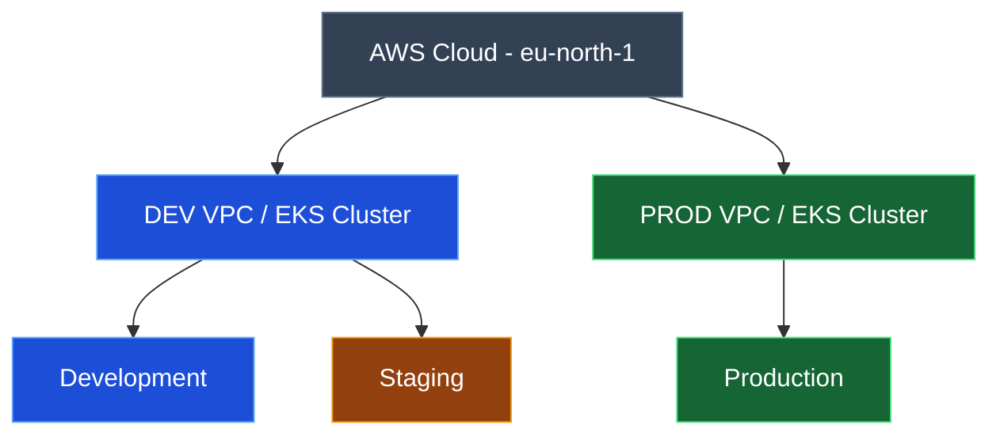

# Infrastructure Deployment - DevOps Assignment

## Overview

DevOps technical assignment - build and deploy Flask application while using modern tools and IaC

### Application

Flask application that runs on port 5050.

App has three endpoints:
 
* /         - Returns the application message, environment, and log level.
* /health   - returns a health status with HTTP 200.
* /version  - returns the version of the app
 
## Technology Stack

* **Python / Flask** - Application development.
* **Gunicorn** - WSGI application server.
* **Docker** - Application containerization.
* **Docker Hub** - Container image registry.
* **GitHub Actions** - CI/CD automation and image promotion.
* **Ruff** - Python code linting.
* **Pytest** - Automated application testing.
* **Kubernetes / Amazon EKS** - Container orchestration.
* **Helm** - Kubernetes application packaging and configuration.
* **Argo CD** - GitOps-based continuous delivery.
* **OpenTufu** - Infrastructure provisioning using IaC.
* **Terragrunt** - OpenTofu configuration and dependency management.
* **AWS VPC** - Cloud networking and environment isolation.
* **AWS IAM** - Identity and access management.
* **AWS Load Balancer Controller** - Application ingress and traffic routing.
* **AWS Secrets Manager** - Secure storage of application secrets.
* **External Secrets Operator** - Synchronization of AWS secrets into Kubernetes.
* **Amazon S3** - Remote state storage and state locking.

## Architecture

The infrastructure consists of two isolated Amazon EKS clusters,
each deployed in a separate VPC.

* **DEV Cluster** - Hosts the Development and Staging environments
  in separate Kubernetes namespaces.
* **PROD Cluster** - Hosts the Production environment in a dedicated
  Kubernetes cluster.

This architecture provides infrastructure isolation between
production and non-production environments.

Each cluster uses Argo CD for GitOps-based deployments,
AWS Load Balancer Controller for application ingress, and
External Secrets Operator for secret management.

## Infrastructure Sizing

The project was deployed using the AWS Free Tier plan,
with cost and resource limitations taken into consideration.

| Cluster | Instance Type | Worker Nodes | vCPU per Node | RAM per Node |
|---------|---------------|--------------|---------------|--------------|
| DEV | m7i-flex.large | 1 | 2 | 8 GiB |
| PROD | c7i-flex.large | 2 | 2 | 4 GiB |

The DEV cluster uses a single worker node shared by
the Development and Staging environments to reduce costs.

The PROD cluster uses two worker nodes across two
Availability Zones to improve application availability
and reduce the impact of a single worker node failure.

The infrastructure is created for testing and validation
and destroyed when it is no longer needed to minimize costs.

## CI/CD

The CI/CD process is managed using GitHub Actions and Argo CD.

* Dev - Automated testing, image build, and deployment.
* Staging - Controlled image promotion through a Pull Request.
* Prod - Controlled image promotion through a manually merged Pull Request.

The pipeline follows the Build Once, Deploy Many principle,
promoting the same Docker image across all environments
without rebuilding it.

Argo CD manages application deployments by synchronizing
the desired configuration from Git to Kubernetes.

## Deployment

The infrastructure is provisioned using OpenTufu and Terragrunt.

The deployment process includes:

* Provisioning AWS networking and EKS clusters.
* Installing Kubernetes add-ons.
* Setting up Argo CD and its applications.
* Deploying the application using GitOps.
* Verifying application availability.

Infrastructure cleanup is managed through Terragrunt,
followed by AWS resource verification.

## Documentation

| Component | Documentation |
|-----------|---------------|
| Application & Docker | [README](app/README.MD) |
| GitHub Actions | [README](.github/CI-CD.MD) |
| Helm | [README](helm/README.MD) |
| Argo CD | [README](argocd/README.MD) |
| Terraform | [README](terraform/README.MD) |
| Terragrunt | [README](terragrunt/README.MD) |
| Deployment Scripts | [README](scripts/README.MD) |