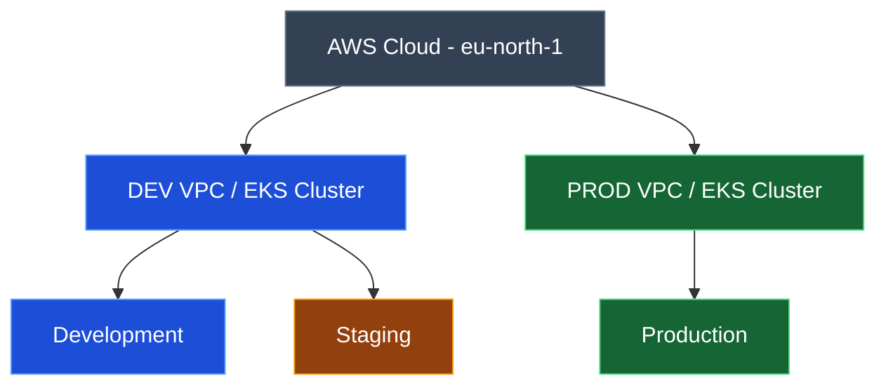

# Infrastructure Deployment - DevOps Assignment

## Overview

DevOps technical assignment - build and deploy Flask application while using modern tools and IaC

### Application

Flask application that runs on port 5050.

App has three endpoints:
 
* /         - Returns the application message, environment, and log level.
* /health   - returns a health status with HTTP 200.
* /version  - returns the version of the app
 
## Technology Stack

* **Python / Flask** - Application development.
* **Gunicorn** - WSGI application server.
* **Docker** - Application containerization.
* **Docker Hub** - Container image registry.
* **GitHub Actions** - CI/CD automation and image promotion.
* **Ruff** - Python code linting.
* **Pytest** - Automated application testing.
* **Kubernetes / Amazon EKS** - Container orchestration.
* **Helm** - Kubernetes application packaging and configuration.
* **Argo CD** - GitOps-based continuous delivery.
* **Terraform** - Infrastructure provisioning using IaC.
* **Terragrunt** - Terraform configuration and dependency management.
* **AWS VPC** - Cloud networking and environment isolation.
* **AWS IAM** - Identity and access management.
* **AWS Load Balancer Controller** - Application ingress and traffic routing.
* **AWS Secrets Manager** - Secure storage of application secrets.
* **External Secrets Operator** - Synchronization of AWS secrets into Kubernetes.
* **Amazon S3** - Remote state storage and state locking.

## Architecture

The infrastructure consists of two isolated Amazon EKS clusters,
each deployed in a separate VPC.

* **DEV Cluster** - Hosts the Development and Staging environments
  in separate Kubernetes namespaces.
* **PROD Cluster** - Hosts the Production environment in a dedicated
  Kubernetes cluster.

This architecture provides infrastructure isolation between
production and non-production environments.

Each cluster uses Argo CD for GitOps-based deployments,
AWS Load Balancer Controller for application ingress, and
External Secrets Operator for secret management.

## Infrastructure Sizing

The project was deployed using the AWS Free Tier plan,
with cost and resource limitations taken into consideration.

Infrastructure costs are covered by AWS Free Tier credits.
Additional charges may apply when using a paid AWS account.

| Cluster | Instance Type | Worker Nodes | vCPU per Node | RAM per Node |
|---------|---------------|--------------|---------------|--------------|
| DEV | m7i-flex.large | 1 | 2 | 8 GiB |
| PROD | c7i-flex.large | 2 | 2 | 4 GiB |

The DEV cluster uses a single worker node shared by
the Development and Staging environments to reduce costs.

The PROD cluster uses two worker nodes with subnets
in two Availability Zones to improve application availability
and reduce the impact of a single worker node failure.

During testing, the worker nodes were successfully
distributed across two Availability Zones.

The infrastructure is created for testing and validation
and destroyed when it is no longer needed to minimize costs.

## CI/CD

The project uses one long-lived source branch, `main`, and two workflows:

* **CI** - Runs Python and Helm checks for pull requests and pushes to main.
  Relevant changes on main, or a manual run on main, also build, smoke-test
  and publish an image to Docker Hub with release metadata.
* **Promotion** - Runs manually with a target environment and a successful
  CI run ID. It opens a Pull Request that updates only the selected
  Argo CD Application.

A release combines a Git commit containing the Helm chart and configuration
with an immutable image digest. Promotion reuses that image across
Development, Staging and Production without rebuilding it.

Each environment tracks its own pinned Git commit. Root Applications track
main to pick up merged promotion changes. Editing Helm files on main alone
does not update an environment until its pinned revision is promoted.

Staging requires the same release to be recorded in Development first;
Production requires it in Staging first. Review and merge the promotion PR
after checking the previous environment's health. The workflow checks Git
configuration, not live cluster health. Required reviewer approval must be
enforced separately through GitHub repository rules.

See [CI/CD](.github/CI-CD.MD) for promotion and rollback instructions.

## Deployment

The infrastructure is provisioned using Terraform and Terragrunt.

The deployment process includes:

* Provisioning AWS networking and EKS clusters.
* Installing Kubernetes add-ons.
* Setting up Argo CD and its applications.
* Deploying the application using GitOps.
* Verifying application availability.

Infrastructure cleanup is managed through Terragrunt,
followed by AWS resource verification.

## TLS Strategy

The demo uses HTTP. For HTTPS, we would terminate TLS at the ALB using an
ACM certificate and redirect HTTP to HTTPS. The ALB would forward traffic
to the Pods over HTTP.

See [Helm](helm/webapp/helm.md#tls-termination-strategy) for the planned setup.

## Documentation

| Component | Documentation |
|-----------|---------------|
| Application & Docker | [README](app/README.MD) |
| GitHub Actions | [README](.github/CI-CD.MD) |
| Helm | [README](helm/webapp/helm.md) |
| Argo CD | [README](argocd/argo.md) |
| Terraform | [README](terraform/terraform.md) |
| Terragrunt | [README](terragrunt/terragrunt.md) |
| Deployment Scripts | [README](scripts/script.md) |
